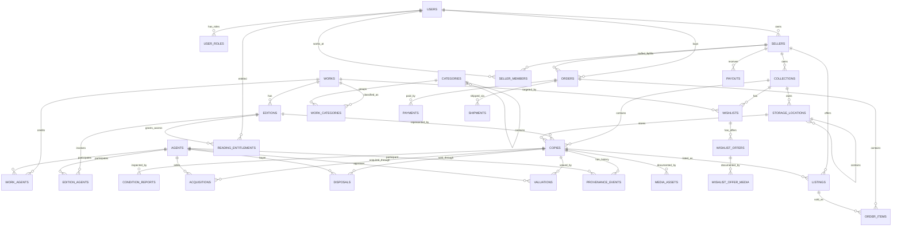

# Sistem Manajemen Koleksi Buku Tua, Langka, dan Bernilai

Dokumentasi desain database, fitur aplikasi, aturan bisnis, alur penggunaan, dan rencana pengembangan sistem koleksi buku pribadi yang sederhana namun tetap dapat dikembangkan menjadi platform katalog profesional.

---

## Ringkasan

Sistem ini dirancang untuk membantu kolektor mencatat, membedakan, memantau, dan menilai buku tua atau bernilai secara terstruktur.

Masalah utama yang diselesaikan adalah bahwa satu judul buku dapat memiliki banyak:

- edisi;
- cetakan;
- penerbit;
- percetakan;
- bahasa;
- jilid;
- varian sampul;
- kondisi fisik;
- riwayat kepemilikan;
- nilai pasar;
- eksemplar fisik.

Karena itu, sistem tidak menyimpan semua informasi dalam satu tabel besar. Fondasi datanya memisahkan tiga tingkat utama:

```text
Karya
└── Edisi / Cetakan / Varian
    └── Eksemplar fisik milik kolektor
```

Contoh:

```text
Karya:
Di Bawah Bendera Revolusi

Edisi:
Jilid I, penerbit tertentu, tahun 1964, cetakan tertentu

Eksemplar:
Buku fisik dengan kode BK-IND-0001, kondisi Good,
memiliki stempel pemilik lama, disimpan di Rak A-02
```

Pemisahan ini memungkinkan satu karya memiliki banyak edisi, dan satu edisi memiliki banyak eksemplar fisik dengan kondisi serta nilai yang berbeda.

---

## Tujuan Sistem

Sistem dikembangkan untuk:

1. Membuat katalog koleksi buku yang rapi dan dapat dicari.
2. Membedakan karya, edisi, cetakan, varian, dan eksemplar fisik.
3. Menyimpan informasi kondisi buku secara berkala.
4. Mencatat harga beli dan seluruh biaya akuisisi.
5. Menyimpan riwayat estimasi nilai pasar.
6. Mendokumentasikan provenance atau riwayat kepemilikan.
7. Menyimpan foto sampul, halaman judul, kerusakan, kuitansi, dan sertifikat.
8. Mengetahui posisi fisik buku pada ruang, lemari, rak, atau kotak.
9. Mengelola daftar buku buruan.
10. Menjadi fondasi untuk pengembangan fitur autentikasi, konservasi, lelang, peminjaman, dan dashboard investasi koleksi.

---

## Prinsip Desain

### Sederhana untuk digunakan

Pengguna tidak diwajibkan mengisi seluruh kolom saat pertama kali memasukkan buku. Data dapat dilengkapi secara bertahap.

### Tidak mencampur karya dengan benda fisik

Judul dan isi intelektual disimpan sebagai `works`, sedangkan buku yang benar-benar dimiliki disimpan sebagai `copies`.

### Riwayat tidak ditimpa

Kondisi dan valuasi disimpan sebagai catatan baru berdasarkan tanggal. Catatan lama tetap tersedia untuk melihat perubahan dari waktu ke waktu.

### Dapat dikembangkan tanpa mengubah fondasi

Tabel tambahan dapat dibuat di masa depan tanpa harus menggabungkan atau merombak tabel inti.

### Mendukung lebih dari satu koleksi

Satu sistem dapat menampung beberapa koleksi, misalnya:

- Koleksi Pribadi Utama;
- Koleksi Buku Sejarah;
- Koleksi Edisi Baca;
- Koleksi Keluarga;
- Koleksi Titipan;
- Koleksi yang disiapkan untuk dijual.

---

## Cakupan Fitur

### Pengguna, Peran, dan Hak Akses

Fondasi keamanan untuk marketplace multi-penjual. Model peran disusun tiga lapis.

Lapis platform (global, satu akun bisa punya beberapa):

- `guest` — lihat katalog publik dan halaman preview gratis;
- `buyer` — beli buku dan baca yang menjadi haknya (default semua akun);
- `seller` — punya storefront, kelola inventaris dan listing sendiri;
- `admin` — kelola platform, pengguna, dan moderasi.

Lapis toko (staf per penjual):

- `owner` — pemilik toko, kontrol penuh;
- `manager` — kelola listing, harga, dan order;
- `staff` — input katalog dan kondisi, tanpa akses harga atau dana.

Lapis hak baca (entitlement, bukan peran):

- hak membaca isi buku diberikan per edisi dari sumber `purchase`, `subscription`, `preview`, atau `grant`;
- preview gratis diatur lewat `editions.preview_free_pages`.

Tabel utama:

- `users`;
- `user_roles`;
- `sellers`;
- `seller_members`;
- `reading_entitlements`;
- `audit_logs`.

Koleksi kini dimiliki oleh toko melalui `collections.seller_id`. Untuk penggunaan pribadi, satu pengguna cukup menjadi `owner` dari satu toko tanpa listing publik.

---

### Manajemen Koleksi

Fitur:

- membuat beberapa koleksi;
- memberi kode unik pada setiap koleksi;
- menentukan mata uang utama;
- melihat jumlah buku per koleksi;
- memindahkan atau mengelompokkan eksemplar;
- memisahkan koleksi inti, koleksi baca, dan duplikat.

Tabel utama:

- `collections`;
- `copies`;
- `storage_locations`.

---

### Katalog Karya

Fitur:

- mencatat judul baku;
- mencatat judul asli;
- mencatat bahasa asli;
- mencatat tahun pertama karya diterbitkan;
- menentukan jenis karya;
- menulis ringkasan subjek;
- menulis abstrak;
- menjelaskan signifikansi sejarah;
- menghubungkan karya dengan penulis, editor, penerjemah, ilustrator, dan kontributor lain.

Tabel utama:

- `works`;
- `work_agents`;
- `agents`;
- `categories`;
- `work_categories`.

---

### Pengelolaan Edisi, Cetakan, dan Varian

Fitur:

- mencatat edisi;
- mencatat cetakan atau impression;
- mencatat issue;
- mencatat state;
- mencatat varian;
- mencatat tahun dan tempat terbit;
- mencatat bahasa edisi;
- mencatat jilid dan seri;
- mencatat ISBN;
- mencatat jumlah cetakan terbatas;
- mencatat jumlah halaman;
- mencatat ringkasan collation;
- mencatat dasar identifikasi edisi;
- menghubungkan edisi dengan penerbit, percetakan, distributor, dan penjilid.

Tabel utama:

- `editions`;
- `edition_agents`;
- `agents`.

---

### Inventaris Eksemplar Fisik

Fitur:

- memberi nomor inventaris;
- memberi accession number;
- membuat barcode;
- membuat QR code;
- mencatat nomor eksemplar pada limited edition;
- menentukan status buku;
- menentukan tingkat kepentingan koleksi;
- mencatat kelengkapan;
- mencatat keaslian binding;
- mencatat dust jacket dan slipcase;
- mencatat ukuran dan berat;
- mencatat lokasi buku saat ini.

Tabel utama:

- `copies`;
- `storage_locations`.

---

### Pemeriksaan Kondisi

Fitur:

- membuat laporan kondisi berkala;
- menyimpan grade kondisi;
- menyimpan skor kondisi;
- menilai sampul, punggung, jilidan, dan kertas;
- mencatat foxing;
- mencatat jamur;
- mencatat kerusakan serangga;
- mencatat bekas air;
- mencatat sobekan;
- mencatat tulisan atau tanda pada buku;
- menandai risiko aktif;
- menuliskan rekomendasi penanganan;
- menjadwalkan inspeksi berikutnya.

Tabel utama:

- `condition_reports`.

Setiap eksemplar dapat memiliki banyak laporan kondisi sehingga perubahan kondisi dapat dipantau.

---

### Akuisisi dan Modal

Fitur:

- mencatat pembelian;
- mencatat pembelian lelang;
- mencatat hadiah atau warisan;
- mencatat penjual;
- mencatat kanal transaksi;
- mencatat lokasi transaksi;
- mencatat nomor faktur;
- mencatat harga beli;
- mencatat ongkos kirim;
- mencatat pajak;
- mencatat buyer's premium;
- mencatat biaya restorasi awal;
- mencatat biaya tambahan;
- mencatat metode pembayaran;
- mencatat bukti transaksi.

Tabel utama:

- `acquisitions`;
- `agents`;
- `copies`.

Rumus total modal:

```text
Total Modal =
Harga Beli
+ Ongkos Kirim
+ Pajak
+ Biaya Lelang
+ Biaya Restorasi Awal
+ Biaya Lain
```

Total modal dapat dihitung oleh aplikasi tanpa disimpan sebagai kolom permanen.

---

### Penjualan dan Pelepasan

Pasangan simetris akuisisi, mencatat saat eksemplar dijual atau dilepas agar laba/rugi yang sebenarnya dapat dihitung.

Fitur:

- mencatat pembeli dan kanal penjualan;
- membedakan harga pasang (`asking_price`) dan harga terjual (`sale_price`);
- mencatat biaya jual: fee platform, ongkir, pajak, biaya lain;
- menghitung hasil bersih dan laba/rugi terealisasi;
- menampilkan harga jual minimum (titik impas) agar tidak rugi.

Tabel utama:

- `disposals`;
- `agents`;
- `copies`.

---

### Marketplace (Jual-Beli)

Platform jual-beli multi-penjual yang menyambungkan penjual, pembeli, pembayaran, dan hak baca.

Fitur:

- penjual memasang listing: eksemplar fisik atau akses baca edisi;
- pembeli memesan lintas toko;
- pembayaran, pengiriman, dan pencairan dana penjual;
- komisi platform per transaksi;
- pembelian fisik otomatis mencatat `disposals`; pembelian akses baca otomatis memberi `reading_entitlements`.

Tabel utama:

- `listings`;
- `orders`;
- `order_items`;
- `payments`;
- `shipments`;
- `payouts`.

Rincian pada [Modul Marketplace](docs/marketplace.md).

---

### Valuasi dan Harga Pasar

Fitur:

- mencatat estimasi nilai rendah;
- mencatat estimasi nilai tengah;
- mencatat estimasi nilai tinggi;
- mencatat nilai asuransi;
- membedakan estimasi pribadi, dealer, lelang, ahli, dan harga realisasi;
- mencatat tren pasar;
- mencatat tingkat likuiditas;
- mencatat dasar penilaian;
- mencatat sumber pembanding;
- memberi masa berlaku penilaian.

Tabel utama:

- `valuations`;
- `agents`;
- `copies`.

Satu eksemplar dapat memiliki banyak valuasi sehingga perkembangan nilai buku dapat dilihat berdasarkan waktu.

---

### Provenance

Provenance adalah riwayat kepemilikan, perpindahan, atau keterkaitan historis sebuah buku.

Fitur:

- mencatat pemilik sebelumnya;
- mencatat pihak yang menyerahkan atau menerima;
- mencatat pembelian, hadiah, warisan, lelang, atau transfer;
- mencatat periode kepemilikan;
- mencatat tempat;
- menyimpan ringkasan bukti;
- menyimpan status verifikasi;
- menyimpan tingkat keyakinan;
- menyusun kronologi dengan nomor urut.

Tabel utama:

- `provenance_events`;
- `agents`;
- `copies`.

Contoh:

| Urutan | Peristiwa | Pemilik | Periode | Bukti |
|---:|---|---|---|---|
| 1 | Dimiliki | A. Soedarmo | 1964–1978 | Tanda tangan |
| 2 | Transfer | Perpustakaan X | 1978–2005 | Stempel |
| 3 | Dibeli | Kolektor Y | 2005–2026 | Kuitansi |
| 4 | Dibeli | Koleksi saat ini | 2026–sekarang | Bukti transaksi |

---

### Dokumentasi Foto dan Berkas

Fitur:

- foto sampul depan;
- foto sampul belakang;
- foto punggung;
- foto halaman judul;
- foto halaman hak cipta;
- foto daftar isi;
- foto halaman terakhir;
- foto tanda tangan;
- foto stempel;
- foto kerusakan;
- unggahan kuitansi;
- unggahan sertifikat;
- checksum untuk mendeteksi file duplikat atau perubahan file.

Tabel utama:

- `media_assets`.

Rekomendasi pola nama file:

```text
BK-IND-0001_cover-front.jpg
BK-IND-0001_cover-back.jpg
BK-IND-0001_spine.jpg
BK-IND-0001_title-page.jpg
BK-IND-0001_copyright-page.jpg
BK-IND-0001_signature-01.jpg
BK-IND-0001_damage-p125.jpg
BK-IND-0001_receipt.pdf
```

File tidak sebaiknya disimpan langsung sebagai binary besar di database. Database menyimpan metadata dan lokasi penyimpanan file.

---

### Lokasi Penyimpanan

Fitur:

- membuat struktur lokasi bertingkat;
- menyimpan ruang;
- menyimpan lemari;
- menyimpan rak;
- menyimpan kotak;
- menandai lokasi dengan pengendalian iklim;
- menandai lokasi aman;
- menentukan lokasi buku saat ini.

Tabel `storage_locations` menggunakan relasi terhadap dirinya sendiri melalui `parent_location_id`.

Contoh hierarki:

```text
Ruang Koleksi
└── Lemari A
    └── Rak A-02
        └── Kotak BOX-04
```

---

### Daftar Buruan

Fitur:

- mencatat judul target;
- menghubungkan target ke karya yang sudah ada;
- mencatat edisi yang diinginkan;
- mencatat cetakan yang diinginkan;
- mencatat tahun target;
- mencatat penerbit target;
- menentukan kondisi minimum;
- menentukan anggaran maksimum;
- memberi prioritas;
- mencatat status pencarian;
- mengumpulkan banyak penawaran per target dari toko, olshop, atau sosmed berbeda;
- membandingkan harga, kondisi, dan ketersediaan antar penawaran;
- menyimpan foto/screenshot tiap penawaran;
- menandai penawaran terpilih untuk dibeli.

Tabel utama:

- `wishlists`;
- `wishlist_offers`;
- `wishlist_offer_media`;
- `works`;
- `collections`.

---

## Arsitektur Data

### Diagram Konseptual



Modul Reader (`book_pages`, `book_chapters`, `ai_analyses`, `book_entity_mentions`, `places`) menempel pada `copies`/`editions` dan dibahas terpisah pada [Modul Reader dan Analisis AI](docs/reader-module.md).

---

## OCR & Fallback VLM (Status: terintegrasi ke endpoint produksi, async)

`ocr-service/` (Python/FastAPI) menjalankan OCR lokal lewat RapidOCR/ONNXRuntime sebagai engine utama, ditambah lapisan koreksi opsional berbasis VLM (Vision-Language Model) untuk halaman yang hasil bacanya lemah. Lapisan VLM ini **bukan pengganti** RapidOCR — RapidOCR tetap jalan duluan untuk semua halaman (cepat, gratis, lokal); VLM hanya dipanggil sebagai *fallback* pada halaman yang ditandai `low_coverage` (confidence tinggi tapi teks yang terdeteksi jauh lebih sedikit dari yang seharusnya ada di halaman — indikasi under-read, bukan cuma error OCR biasa).

### Tech stack

| Lapisan | Komponen | Peran |
|---|---|---|
| OCR utama | RapidOCR (PP-OCR via ONNXRuntime) | Baca semua halaman, lokal, tanpa biaya |
| Segmentasi bentang | `segment.py` (heuristik geometris) | Deteksi 1 halaman / 1 dominan / 2 halaman (spread) |
| VLM fallback #1 | Gemini 2.5 Flash (Google, cloud API) | Baca ulang halaman `low_coverage`; free tier 20 req/hari |
| VLM fallback #2 | `google/gemma-4-26b-a4b-it:free` lewat OpenRouter (cloud API) | Dipanggil otomatis kalau Gemini gagal/kena rate-limit |
| Modul kode | `ocr-service/vlm_assist.py` | Implementasi rantai fallback + prompt |
| Eval harness | `ocr-service/eval/run_books.py --vlm-fallback` | Ukur CER before/after pada dataset 5 buku berlabel |
| Endpoint async | `POST /ocr/vlm-reread` (`ocr-service/app.py`) | Terima job reread, balas 202 langsung, proses di `BackgroundTasks`, callback ke Go |
| Trigger produksi | `reader.Handler.triggerVLMReread` (`backend/internal/domain/reader/handler.go`) | Dipanggil dari `UploadPage` untuk tiap halaman `low_coverage`, fire-and-forget (goroutine) |
| Webhook penerima | `POST /api/v1/reader/ocr/callback` (`reader.Handler.OCRWebhook`) | Update `book_pages.ocr_text`/`ocr_provider`, diverifikasi header `X-Webhook-Secret` |
| Migrasi | `backend/migrations/0006_book_pages_vlm_fallback.sql` | Kolom `low_coverage`, `ocr_provider` di `book_pages` |

Kredensial (`GEMINI_API_KEY`, `OPENROUTER_API_KEY`) disimpan di `ocr-service/.env` (di-gitignore, lihat `ocr-service/.env.example`) — **tidak** dikirim ke database atau kode yang di-commit. Shared secret webhook (`OCR_WEBHOOK_SECRET`) disimpan sama-sama di `backend/.env` dan diteruskan ke `ocr-service` per-request (bukan env terpisah di sana), lihat `backend/.env.example`.

### Alur baca satu halaman

```text
Foto halaman
 └─ RapidOCR baca teks + confidence per kotak                    [lokal, selalu jalan]
     └─ segment_pages(): tentukan layout (single/dominant/spread)
     └─ hitung metrik coverage → tandai low_coverage bila under-read

     ┌─ low_coverage == false ────────────────────────────────────┐
     │   teks RapidOCR dipakai apa adanya                        │
     └─────────────────────────────────────────────────────────────┘

     ┌─ low_coverage == true (opsional, hanya bila fallback aktif) ┐
     │   vlm_assist.read_page(foto, teks_rapidocr, side):          │
     │     1. Coba Gemini 2.5 Flash                                │
     │        - kirim foto UTUH halaman + teks RapidOCR sbg acuan  │
     │        - prompt minta transkripsi ulang + tag struktur      │
     │          [JUDUL]/[PARAGRAF]/[HALAMAN]/[GAMBAR&TEKS]         │
     │        - guard khusus: kalau halaman berupa peta/diagram    │
     │          berlabel banyak, JANGAN transkrip tiap label kecil,│
     │          cukup caption/legend (mencegah CER meledak akibat  │
     │          VLM terlalu rajin membaca semua label)             │
     │        - gagal (429/error apa pun)? lanjut ke langkah 2     │
     │     2. Fallback: OpenRouter, model gemma-4-26b-a4b-it:free  │
     │        - prompt & guard sama, provider beda                 │
     │        - kalau ini juga gagal → lempar error, teks RapidOCR │
     │          asli tetap dipakai (VLM murni upgrade, bukan       │
     │          dependency keras)                                  │
     │   hasil: (teks_baru, nama_provider_yang_berhasil)            │
     └───────────────────────────────────────────────────────────────┘
```

### Alur produksi (async, lintas service)

VLM fallback di produksi **tidak memblokir** response upload halaman — pengguna langsung dapat hasil RapidOCR, teks yang lebih baik menyusul belakangan begitu VLM selesai:

```text
POST /api/v1/copies/{copyID}/pages (backend Go)
 └─ ocrclient.Recognize() → RapidOCR baca semua halaman             [sinkron]
     └─ simpan tiap halaman ke book_pages (ocr_text, low_coverage)
     └─ response langsung dikembalikan ke pengguna                  [selesai di sini]

     ┌─ untuk tiap halaman dengan low_coverage == true ─────────────────┐
     │   go func() triggerVLMReread(...)                    [goroutine, tidak diawait]
     │     └─ POST ocr-service /ocr/vlm-reread (image, ocr_text, side,  │
     │        book_page_id, callback_url, callback_secret)             │
     │        → ocr-service balas 202 Accepted SEKETIKA                │
     │            └─ BackgroundTasks: vlm_assist.read_page()           │
     │               (Gemini → OpenRouter/Gemma, lihat alur di atas)   │
     │               └─ POST balik ke callback_url:                    │
     │                  { book_page_id, text, provider }                │
     │                  header X-Webhook-Secret                        │
     │                    └─ Go: OCRWebhook verifikasi secret           │
     │                       → UPDATE book_pages SET ocr_text=...,      │
     │                         ocr_provider=..., ocr_engine='vlm:...'   │
     └───────────────────────────────────────────────────────────────────┘
```

Karena async, klien (frontend) perlu polling/refresh `GET /copies/{copyID}/pages` untuk melihat teks yang sudah diperbarui — belum ada push/websocket. Kegagalan di titik mana pun pada cabang VLM (Gemini & OpenRouter dua-duanya gagal, network timeout, dst.) cuma di-log di kedua sisi; `book_pages` tetap berisi hasil RapidOCR asli, tidak pernah kosong atau error ke pengguna.

### Hasil eval (dataset 5 buku, 48 halaman berlabel)

- CER RapidOCR-only (semua halaman): **0.229** (akurasi karakter 77,1%)
- Pada 9 halaman `low_coverage` yang diuji fallback VLM: CER turun dari **0,312 → 0,067** (real-world, sebagian besar lewat fallback Gemma karena kuota harian Gemini habis saat pengujian)
- Guard anti-halusinasi peta/diagram terbukti bekerja lintas provider (halaman peta subway: CER 0,723 → 0,007)
- Alur produksi (goroutine → webhook → update DB) sudah diuji end-to-end secara nyata (bukan simulasi): halaman dengan RapidOCR gagal total (`ocr_text=""`) berhasil diisi ulang lewat fallback Gemma dan `book_pages` ter-update otomatis; callback tanpa secret yang benar ditolak (401)

### Catatan & keterbatasan yang diketahui

- Belum ada pola job/queue "resmi" di `backend/` — `triggerVLMReread` memakai goroutine polos (`go func`), bukan job queue persisten. Kalau proses backend restart persis saat goroutine sedang berjalan, reread itu hilang begitu saja (tidak di-retry). Cukup untuk skala saat ini; pertimbangkan queue sungguhan (mis. tabel job + worker) kalau volume upload naik jauh.
- Free tier Gemini 20 request/hari dan ketersediaan model gratis di OpenRouter bisa berubah sewaktu-waktu (lihat catatan di [vlm_assist.py](ocr-service/vlm_assist.py)) — pantau log `[vlm-reread] gagal ...` di `ocr-service` bila fallback sering gagal total.
- Baris "Semua pemrosesan berjalan lokal/offline" pada [Modul Reader](docs/reader-module.md) sudah direvisi untuk mencerminkan fallback VLM cloud ini.

---

### Relasi Utama

### Karya ke Edisi

```text
works 1 ─── N editions
```

Satu karya dapat memiliki banyak edisi.

### Edisi ke Eksemplar

```text
editions 1 ─── N copies
```

Satu edisi dapat dimiliki dalam lebih dari satu eksemplar fisik.

### Eksemplar ke Kondisi

```text
copies 1 ─── N condition_reports
```

Laporan kondisi bersifat historis.

### Eksemplar ke Valuasi

```text
copies 1 ─── N valuations
```

Nilai buku dapat berubah dan tidak boleh ditimpa.

### Eksemplar ke Provenance

```text
copies 1 ─── N provenance_events
```

Riwayat disusun menggunakan `sequence_no`.

### Koleksi ke Lokasi

```text
collections 1 ─── N storage_locations
```

Lokasi dapat memiliki lokasi induk.

---

## Daftar Tabel

| No. | Tabel | Kelompok | Fungsi Utama |
|---:|---|---|---|
| 1 | `collections` | Inti | Identitas koleksi |
| 2 | `agents` | Inti | Orang dan organisasi |
| 3 | `agent_roles` | Inti | Role umum agent (publisher, printer, seller, dll.) |
| 4 | `works` | Inti | Karya atau judul intelektual |
| 5 | `work_types` | Inti | Master jenis/bentuk benda (buku, atlas, surat) |
| 6 | `author_profiles` | Inti | Detail halaman penulis (bio, foto, sosial) |
| 7 | `work_agents` | Inti | Relasi karya dengan kontributor |
| 8 | `categories` | Inti | Master kategori/subjek (hierarkis) |
| 9 | `work_categories` | Inti | Relasi karya dengan kategori |
| 10 | `editions` | Inti | Versi penerbitan |
| 11 | `edition_agents` | Inti | Relasi edisi dengan penerbit/percetakan |
| 12 | `storage_locations` | Inti | Struktur ruang, lemari, rak, kotak |
| 13 | `copies` | Inti | Eksemplar fisik yang dimiliki |
| 14 | `condition_reports` | Inti | Riwayat pemeriksaan kondisi |
| 15 | `acquisitions` | Inti | Riwayat perolehan dan biaya (beli) |
| 16 | `disposals` | Inti | Riwayat pelepasan dan biaya (jual) |
| 17 | `valuations` | Inti | Riwayat nilai dan estimasi harga |
| 18 | `provenance_events` | Inti | Kronologi kepemilikan |
| 19 | `media_assets` | Inti | Metadata foto dan dokumen |
| 20 | `wishlists` | Inti | Target buku buruan |
| 21 | `wishlist_offers` | Inti | Penawaran per target dari banyak toko |
| 22 | `wishlist_offer_media` | Inti | Foto/screenshot penawaran |
| 23 | `languages` | Master | Master bahasa (ISO 639) |
| 24 | `places` | Master | Master tempat (kota/wilayah/negara) |
| 25 | `shipping_carriers` | Master | Master kurir pengiriman |
| 26 | `payment_methods` | Master | Master metode pembayaran |
| 27 | `sales_channels` | Master | Master kanal transaksi |
| 28 | `fx_rates` | Pendukung | Kurs mata uang harian |
| 29 | `users` | Fondasi | Akun pengguna |
| 30 | `user_roles` | Fondasi | Peran platform (buyer/seller/admin) |
| 31 | `sellers` | Fondasi | Storefront/toko penjual |
| 32 | `seller_members` | Fondasi | Staf toko dan peran |
| 33 | `reading_entitlements` | Fondasi | Hak baca isi buku per pengguna |
| 34 | `audit_logs` | Fondasi | Jejak audit perubahan |
| 35 | `listings` | Marketplace | Penawaran jual (copy fisik / akses baca) |
| 36 | `orders` | Marketplace | Transaksi beli |
| 37 | `order_items` | Marketplace | Baris item dalam order |
| 38 | `payments` | Marketplace | Pembayaran pembeli |
| 39 | `shipments` | Marketplace | Pengiriman item fisik |
| 40 | `payouts` | Marketplace | Pencairan dana penjual |
| 41 | `book_pages` | Modul Reader | OCR, koreksi, terjemahan per halaman |
| 42 | `book_chapters` | Modul Reader | Batas bab dan ringkasan |
| 43 | `ai_analyses` | Modul Reader | Hasil analisis AI (dapat dilacak) |
| 44 | `book_entity_mentions` | Modul Reader | Nama/tempat yang muncul di teks |

---

## Dokumentasi Lengkap

Dokumen desain terperinci dipecah ke folder `docs/`:

- [Kamus Data / Dokumentasi Tabel](docs/data-dictionary.md)
- [Enumerasi](docs/enumerations.md)
- [Aturan Bisnis](docs/business-rules.md)
- [Alur Kerja Utama](docs/workflows.md)
- [Tampilan Aplikasi & Pencarian](docs/ui.md)
- [Data Turunan dan Perhitungan](docs/computed.md)
- [API yang Disarankan](docs/api.md)
- [Struktur Proyek & Teknologi](docs/architecture.md)
- [Keamanan & Backup](docs/security-backup.md)
- [Pengujian & Migrasi Data](docs/testing-migration.md)
- [Roadmap, Ekspansi & Dashboard](docs/roadmap.md)
- [Modul Marketplace (Jual-Beli)](docs/marketplace.md)
- [Contoh Data & File Desain](docs/examples.md)
- [Modul Reader dan Analisis AI](docs/reader-module.md)
- [Impor Data Penerbit](docs/publisher-import.md)

Desain skema fisik tersedia di [`dbdiagram-koleksi-buku-sederhana-ekstensibel.dbml`](dbdiagram-koleksi-buku-sederhana-ekstensibel.dbml).

## Impor Penerbit

Data penerbit massal dapat diimpor dari CSV ke `agents` dan `agent_roles`.
Importer juga mengisi `publisher_category` dan menormalkan status agar batch otomatis tidak menandai semua penerbit sebagai aktif tanpa bukti operasional.

```bash
cd backend
make import-publishers FILE=../data/templates/publishers.csv.example
```

Batch awal dari Wikidata tersedia di:

```text
data/import/publishers_wikidata_batch_001.csv
data/import/publishers_wikidata_enrichment_002.csv
data/import/publishers_legal_name_enrichment_003.csv
data/import/publishers_ikapi_members_2026_05_01.csv
```

Batch IKAPI diambil dari endpoint publik anggota IKAPI per 1 Mei 2026 dan berisi 2.084 baris. Perpusnas ISBN dipakai sebagai rujukan statistik/verifikasi; endpoint publik yang ditemukan saat ini menyediakan agregat penerbit/ISBN, bukan dump daftar penerbit siap impor.

Panduan field, validasi, dan sumber data ada di [docs/publisher-import.md](docs/publisher-import.md).

# Kesimpulan

Desain ini sengaja dibuat tidak terlalu besar untuk tahap awal, tetapi tetap memakai struktur yang benar.

Fondasi yang harus dipertahankan adalah:

```text
works
└── editions
    └── copies
```

Selama tiga lapisan tersebut tidak digabung, sistem dapat dikembangkan dari katalog pribadi menjadi:

- sistem inventaris kolektor;
- katalog buku langka;
- sistem dokumentasi provenance;
- sistem konservasi;
- sistem valuasi;
- katalog perpustakaan khusus;
- platform penjualan atau lelang;
- dashboard investasi koleksi.

Skema terdiri dari 18 tabel inti, tabel pendukung (`fx_rates`), fondasi identitas (`users`, `user_roles`, `sellers`, `seller_members`, `reading_entitlements`, `audit_logs`), modul marketplace (`listings`, `orders`, `order_items`, `payments`, `shipments`, `payouts`), dan modul reader — total 44 tabel. Fitur baru sebaiknya ditambahkan sebagai modul dan tabel terpisah, bukan dengan terus menambah kolom pada `copies`.

---

## Status Dokumen

- Jenis: dokumentasi teknis dan fungsional
- Database target: relasional
- Rekomendasi implementasi: PostgreSQL
- Format desain: DBML
- Karakter desain: sederhana, modular, dan extensible
